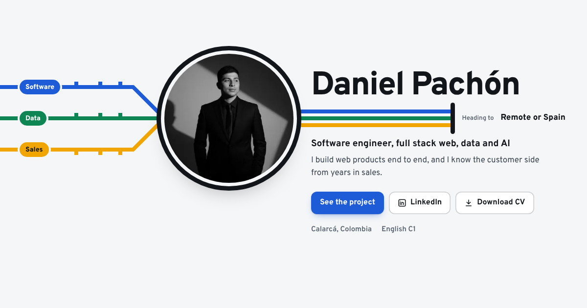

# danielpachon.github.io

My personal portfolio: **[danielpachon.github.io](https://danielpachon.github.io)**

A fast, bilingual (English and Spanish) static site built with [Astro](https://astro.build), animated with [GSAP](https://gsap.com) and [Lenis](https://lenis.darkroom.engineering), with components from [React Bits](https://reactbits.dev), and deployed to GitHub Pages with GitHub Actions.



## Highlights

- **Bilingual routes** (`/` and `/es/`) with `hreflang` alternates, and a first-visit redirect for Spanish-speaking browsers.
- **Motion with intent**: a GSAP intro (SplitText line masks, photo reveal) that plays once per session, a project screenshot that switches language and theme as you scroll through it, and an experience rail that draws itself with the scroll. Smooth scrolling with Lenis, kept in sync with ScrollTrigger.
- **React Bits islands**: SpotlightCard for the three disciplines and Magnet on the main calls to action, hydrated only when needed.
- **Reduced motion respected**: with `prefers-reduced-motion`, there is no intro, no smooth scrolling and no scroll-linked effects.
- **Light and dark themes** that follow the system setting and remember the visitor's choice, applied before first paint to avoid a flash.
- **SEO ready**: canonical URLs, Open Graph image, `Person` structured data, sitemap and `robots.txt`.
- **Optimized images** served as responsive WebP through `astro:assets`.
- **Accessible**: semantic sections, skip link, visible focus, keyboard-friendly controls and reduced motion support.
- **Content in one typed file** (`src/i18n/content.ts`), so both languages always stay in sync.

## Development

```bash
npm install
npm run dev      # http://localhost:4321
npm run build    # type-checks and builds to dist/
```

Pushing to `main` deploys automatically through `.github/workflows/deploy.yml`.

## License

Code under the MIT license. Personal content, photo and CV © Daniel Pachón.
